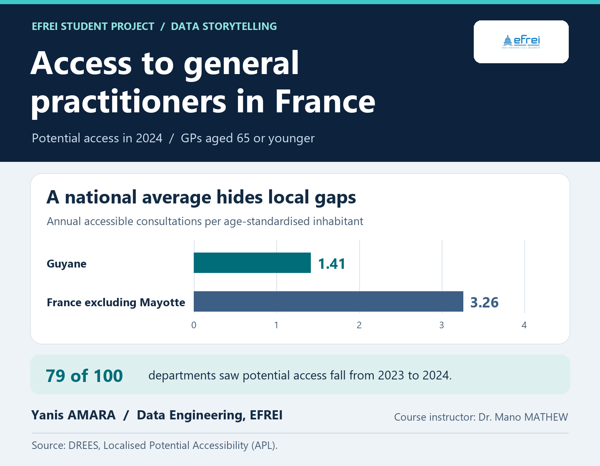

# Access to General Practitioners in France

**[Open the Streamlit dashboard](https://gp-access-france-ahs5sneep9sfvukvtlnrbx.streamlit.app/)** · [Watch the demo (2:28)](https://drive.google.com/file/d/14FoVSiHnxjcu0wHv8CMeZwwxg1eIT0k9/view) · [Read the report](StApp26_20232166_AMARA_DE2/REPORT.pdf)

An interactive dashboard exploring where access to GPs was lower in 2024, what department averages hide, and how access changed from 2023 to 2024. It combines departmental maps and rankings with a closer look at communes and year-over-year change.



## What the data shows

- Potential GP access fell in **79 of 100 departments** between 2023 and 2024.
- **50 departments** had both below-national potential access in 2024 and a decline since 2023.
- Guyane had the lowest department average: **1.41**, compared with **3.26** for France excluding Mayotte.

The project uses [DREES Localised Potential Accessibility data](https://www.data.gouv.fr/datasets/accessibilite-potentielle-localisee-apl-aux-professionnels-de-sante) for GPs aged 65 or younger. APL estimates annual accessible consultations per age-standardised inhabitant. It does not measure appointment waiting times.

## Explore the project

- [Source code and setup instructions](StApp26_20232166_AMARA_DE2/)
- [Analysis notebook](analysis.ipynb) and [data preparation notes](StApp26_20232166_AMARA_DE2/DATA_PREPARATION.md)
- [Storyboard](StApp26_20232166_AMARA_DE2/STORYBOARD.md), [methods and limitations](StApp26_20232166_AMARA_DE2/CONTEXT_AND_LIMITATIONS.md), and [validation results](VALIDATION.json)

To run locally with Python 3.13, open a terminal in the project folder and use:

```text
python -m pip install -r requirements.txt
python -m streamlit run app.py
```

**Yanis AMARA** · Data Engineering, EFREI · Data Analysis & Visualization · Dr. Mano MATHEW
